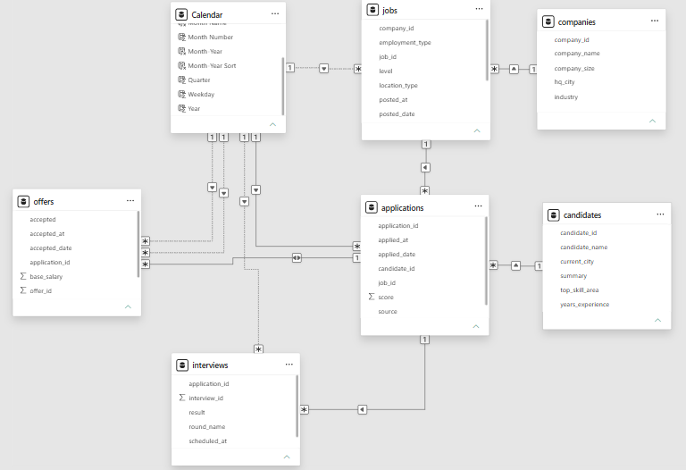
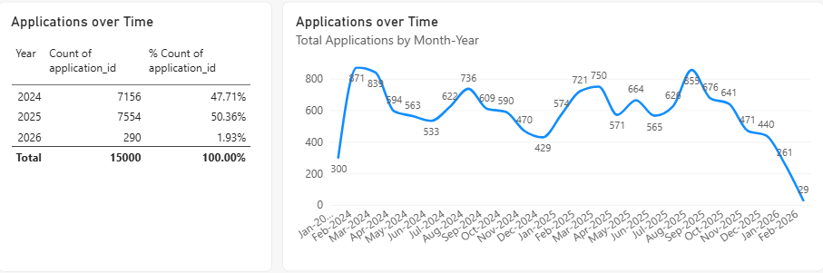
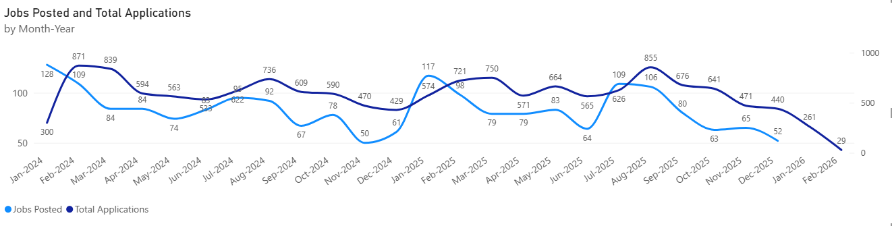
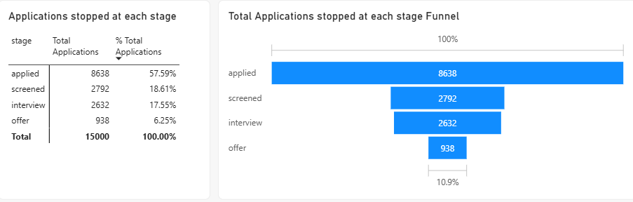
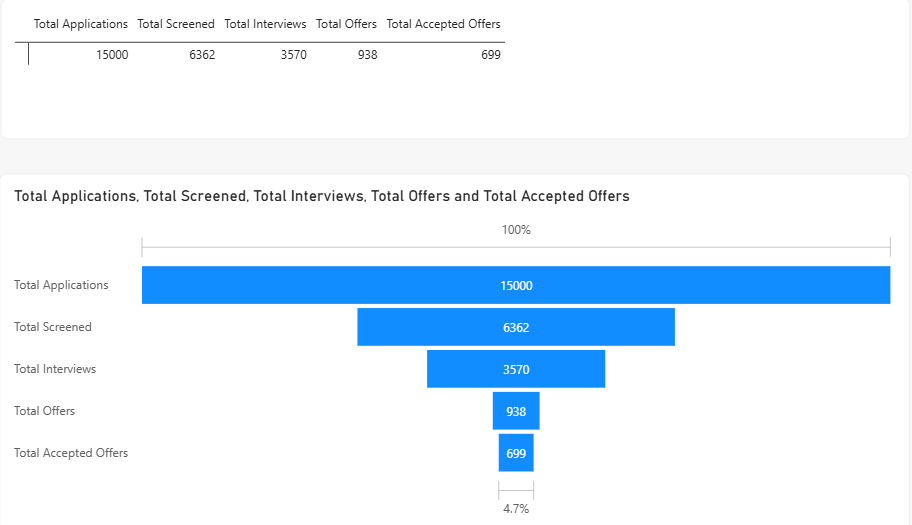
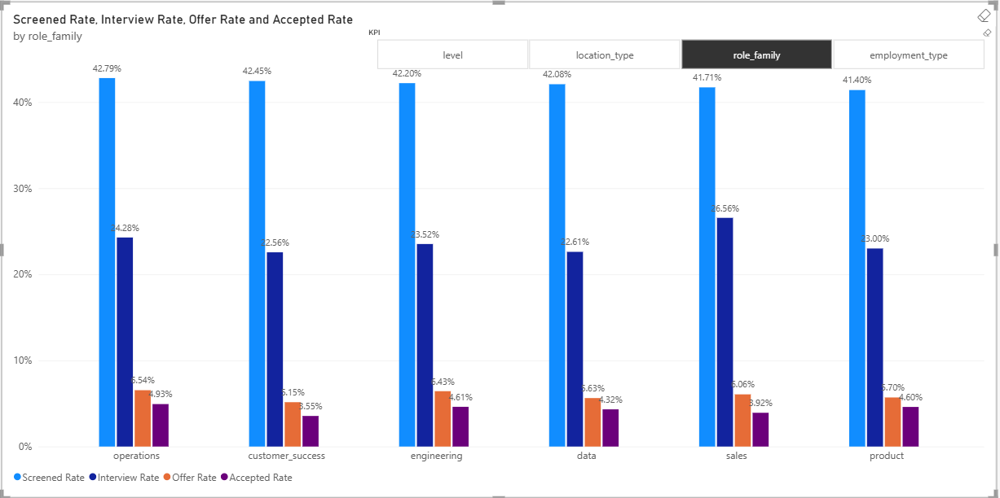
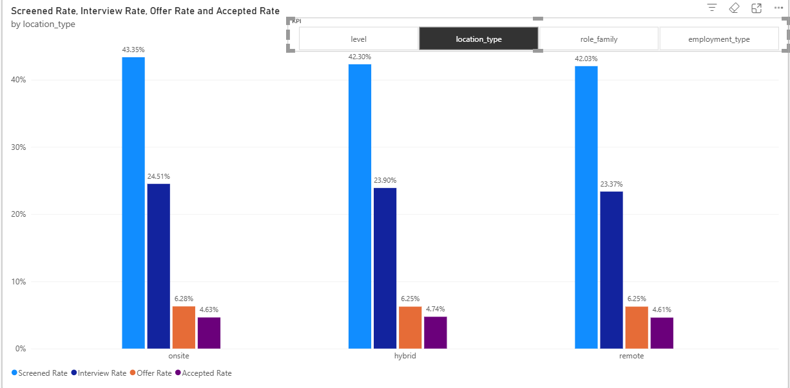
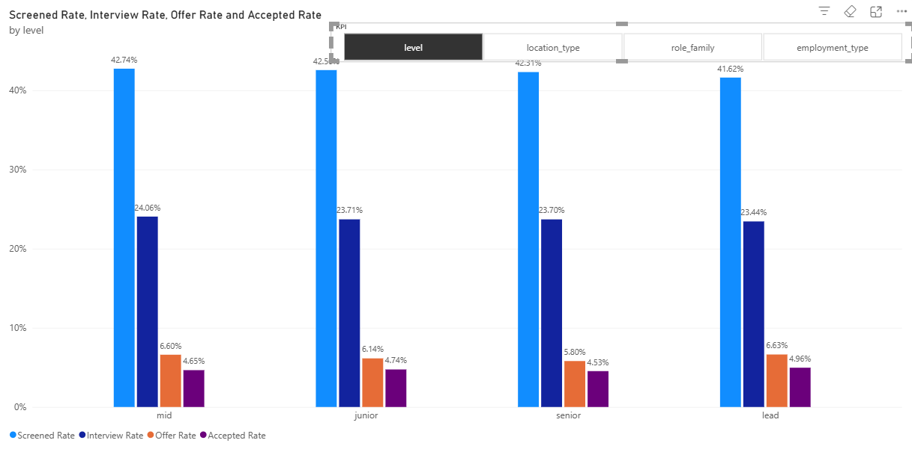
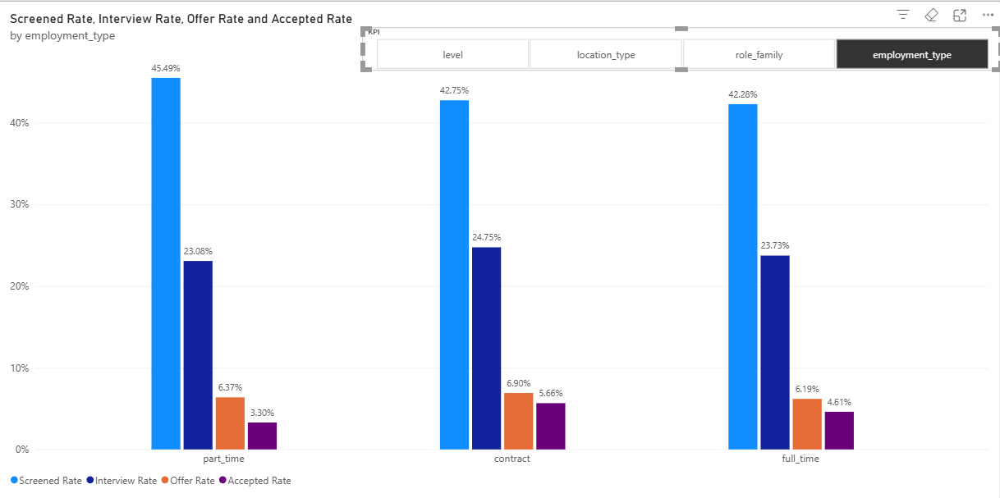

# Recruitment Analytics: Power BI

Power BI report on a hiring pipeline: job postings, applications, interviews, offers and salaries. The goal is to find where candidates drop off, which sources work best, and how offers compare with posted salaries.

SQL part of this project: https://github.com/hajrijemjeku/RecruitmentAnalytics

## Tools
Power BI Desktop, Power Query, DAX (including field parameters for switching the grouping of a chart)

## Data
Dataset: job-postings-applications by mindweave (https://huggingface.co/datasets/mindweave/job-postings-applications),
licensed under CC BY-NC 4.0 (https://creativecommons.org/licenses/by-nc/4.0/).
Changes: data was cleaned and modeled in Power BI.
The original CSV files are in `data/raw/`. The data keeps its own license;
my own work (DAX measures, report design) is separate.

Tables: applications, candidates, companies, interviews, jobs, offers

### Data period
| Event | First | Last |
|---|---|---|
| Job posted | 1 Jan 2024 | 31 Dec 2025 |
| Application | 3 Jan 2024 | 13 Feb 2026 |
| Interview scheduled | 16 Jan 2024 | 12 Mar 2026 |
| Offer accepted | 2 Feb 2024 | 20 Mar 2026 |

## Data Model

- Companies → Jobs → Applications → Offers / Interviews
- Candidates → Applications
- A Date table connects to applications by `applied_date` (active). Relationships to offers (offered and accepted dates), interviews and jobs are inactive and used in DAX measures with `USERELATIONSHIP`.
- `stage_sort` (created in Power Query) puts the stage values in funnel order.

## Hiring Funnel

### How are applications changing over time?

- 15,000 applications: 7,156 in 2024, 7,554 in 2025 (about +5.6%) and 290 in 2026 (applications end on 13 February 2026).
- Applications have two peaks each year: February–March (871 and 839 in 2024; 721 and 750 in 2025) and August (736 in 2024; 855 in 2025, the highest month of that year). They are lowest in December (429 and 440) and dip in June (533 vs 563 in May in 2024; 565 vs 664 in May in 2025).
- The low start in January 2024 (300 vs 574 in January 2025) is consistent with the pipeline starting empty: the first job was posted on 1 January 2024.
- January 2026 (261) is less than half of January 2025 (574), and about 29 applications arrive in the first 13 days of February. This is consistent with no new jobs being posted after 31 December 2025, so applications only arrive for older postings.
- With only two full years, the seasonal pattern is suggestive, not confirmed.

### Jobs posted vs applications

- Jobs posted peak in January in both years (128 in 2024, 117 in 2025) and are lowest in November–December. They also rise in July–August, clearly in 2025 (64 in June to 109 in July) and only slightly in 2024 (83 to 95).
- Application peaks come after posting peaks (January → February–March, July → August), so applications seem to follow postings with a delay of about a month or more. This is a pattern in monthly totals from two years of data, not proof of cause.

### Where do applications stop?

Each application has one stage: the furthest step it reached.

| Stage | Applications | Share |
|---|---|---|
| Applied (never moved on) | 8,638 | 57.6% |
| Screened | 2,792 | 18.6% |
| Interview | 2,632 | 17.5% |
| Offer | 938 | 6.3% |

The largest loss is at the first step. The data has no rejection reasons, so the cause is unknown; some recent applications may still be in progress.

### How many applications reach each step?

| Step | Applications reaching it | % of all applications | % of previous step |
|---|---|---|---|
| Applied | 15,000 | 100% | |
| Screened | 6,362 | 42.4% | 42.4% |
| Interview | 3,570 | 23.8% | 56.1% |
| Offer | 938 | 6.3% | 26.3% |
| Accepted | 699 | 4.7% | 74.5% |

- Overall conversion: 23.8% of applications reach an interview, 6.3% get an offer and 4.7% end in an accepted offer.
- About a quarter of interviewed candidates receive an offer, and about 75% of offers are accepted.

### Does conversion differ by group?
The chart has a slicer to switch between role family, level, location type and employment type (open the .pbix to try it).

- Rates are similar across all four groupings: about 41–45% screened, 22–27% interviewed, 5–7% offered and 3–5% accepted.
- Part-time (455), sales (561) and customer success (563) have far fewer applications than the other groups (2,000+), so their rates are less reliable and small differences there should not be over-interpreted.

## Limitations
- `stage` is read as the furthest step an application reached.
- The data has no rejection reasons, so the analysis shows where candidates drop off, not why.
- Jobs were posted only between 1 January 2024 and 31 December 2025, so applications in early 2026 reflect older postings and are not comparable with earlier months. Only two full years are available.

## In progress
Sourcing channels, candidates, interviews, offers and acceptance, salary, jobs, companies, and time trends.

## How to open
Open `report/RecruitmentAnalytics.pbix` in Power BI Desktop (Windows). To refresh the data, update the file paths in Power Query (Transform data → Data source settings → Change Source).